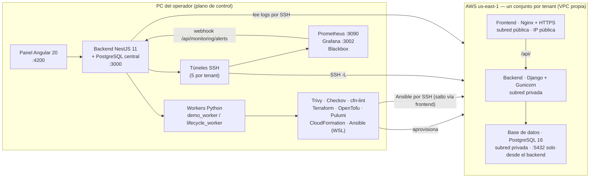
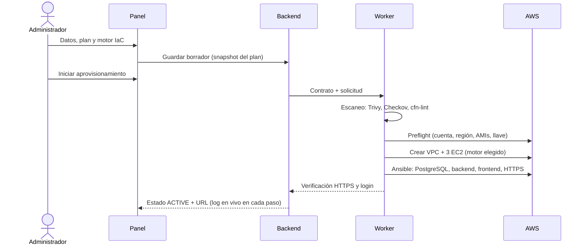

# **UNIVERSIDAD / FACULTAD DE INGENIERÍA EN CIENCIAS DE LA COMPUTACIÓN Y TELECOMUNICACIONES**

## **MÓDULO II: INFRAESTRUCTURA COMO CÓDIGO Y AUTOMATIZACIÓN CLOUD**

**INFORME FINAL DEL PROYECTO**  
**PLATAFORMA MULTI-TENANT PARA GESTIÓN DE REGISTRO DE ASISTENCIA ("TENANT CONTROL CENTER")**  
**Docente:** Ing. \_\_\_\_\_\_\_\_\_\_\_\_\_\_\_\_\_\_\_\_\_\_\_\_\_\_\_\_\_\_  
**Grupo / Equipo:** \_\_\_\_\_\_\_\_\_\_\_\_\_\_\_\_\_\_\_\_\_\_\_\_\_\_\_\_\_\_  
**Fecha de Entrega:** Noviembre de 2026  
**Nómina del Equipo de Desarrollo (6 Integrantes)**

| N° | Rol Técnico y Herramientas Asignadas | Nombre Completo del Integrante | Código / Registro |
| ----- | ----- | ----- | ----- |
| **Integrante 1** | Imágenes Base (Packer \+ cloud-init) y Catálogo de Planes (RF-01, RF-02, RF-13) | \_\_\_\_\_\_\_\_\_\_\_\_\_\_\_\_\_\_\_\_\_\_\_\_\_\_\_\_\_\_ | \_\_\_\_\_\_\_\_\_\_\_\_\_\_ |
| **Integrante 2** | Motor IaC Principal (Terraform) y Registro de Tenants (RF-03, RF-07, RF-08, RF-09) | \_\_\_\_\_\_\_\_\_\_\_\_\_\_\_\_\_\_\_\_\_\_\_\_\_\_\_\_\_\_ | \_\_\_\_\_\_\_\_\_\_\_\_\_\_ |
| **Integrante 3** | Motor IaC Secundario (AWS CloudFormation) y Escáner de Seguridad Pre-Deploy (RF-08, RF-09, RNF) | \_\_\_\_\_\_\_\_\_\_\_\_\_\_\_\_\_\_\_\_\_\_\_\_\_\_\_\_\_\_ | \_\_\_\_\_\_\_\_\_\_\_\_\_\_ |
| **Integrante 4** | Configuración Automatizada (Ansible \+ Vault) y Aislamiento Multi-Tenant (RF-10, RF-21, Entregable 7\) | \_\_\_\_\_\_\_\_\_\_\_\_\_\_\_\_\_\_\_\_\_\_\_\_\_\_\_\_\_\_ | \_\_\_\_\_\_\_\_\_\_\_\_\_\_ |
| **Integrante 5** | Orquestador Web en 2do Plano, Logs en Vivo y Ciclo de Vida (RF-11, RF-14 a RF-18) — *baja del equipo; trabajo retomado y completado por el equipo restante* | \_\_\_\_\_\_\_\_\_\_\_\_\_\_\_\_\_\_\_\_\_\_\_\_\_\_\_\_\_\_ | \_\_\_\_\_\_\_\_\_\_\_\_\_\_ |
| **Integrante 6 (Team Lead)** | Observabilidad (Grafana \+ Alertas), Arquitectura y Documentación (RF-25 a RF-29, Entregables 3, 5, 6, 8\) — *baja del equipo; trabajo retomado y completado por el equipo restante* | \_\_\_\_\_\_\_\_\_\_\_\_\_\_\_\_\_\_\_\_\_\_\_\_\_\_\_\_\_\_ | \_\_\_\_\_\_\_\_\_\_\_\_\_\_ |

**Enlaces Oficiales de Entrega (Entregables 1, 2, 5 y 8\)**

> **Nota — el proyecto es un monorepo.** El código del panel (entregable 1) y el de infraestructura (entregable 2) viven en **un solo repositorio** con carpetas separadas, por lo que ambos enlaces apuntan al mismo lugar. Se explica en la sección 1.4.

| Entregable / Recurso |  |
| ----- | :---- |
| **Entregable 1 — Código fuente (Frontend y Backend del panel):** | \[Pegar enlace del monorepo en GitHub\] — carpetas `apps/` y `packages/` |
| **Entregable 2 — Infraestructura y configuración (IaC):** | \[Pegar el **mismo** enlace del monorepo\] — carpetas `infrastructure/`, `config/` y `scripts/` |
| **Entregable 5 — URL del Tablero de Monitoreo y Alertas (Grafana):** | \[Pegar enlace de Grafana aquí\] — local: `http://localhost:3002` (inicio: «Resumen de la plataforma») |
| **Entregable 8 — Video Demostrativo Final (Máx. 15 minutos):** | \[Pegar enlace de Google Drive aquí\] |

# **ÍNDICE GENERAL**

1. **1\. RESUMEN EJECUTIVO Y ALCANCE DEL PROYECTO**  
   * 1.1. Descripción General de la Solución Multi-Tenant  
   * 1.2. Usuarios del Sistema y Roles Operativos  
   * 1.3. Alcance Funcional Implementado y Nivel de Verificación  
   * 1.4. Organización del Código: Monorepo y Guiones del Video  
2. **2\. CATÁLOGO DE PLANES Y CAPACIDADES (ENTREGABLE 4\)**  
   * 2.1. Estructura de Planes Ofrecidos (RF-01, RF-02, RF-03)  
   * 2.2. Matriz Técnica de Recursos y Límites por Plan  
3. **3\. ARQUITECTURA DEL SISTEMA Y FLUJO DE CREACIÓN DE UN TENANT (ENTREGABLE 3\)**  
   * 3.1. Arquitectura General de Doble Capa  
   * 3.2. Topología de Red y Aislamiento por Tenant en la Nube  
   * 3.3. Flujo Secuencial de Creación y Aprovisionamiento  
   * 3.4. Ciclo de Vida y Estados de un Tenant  
4. **4\. IMPLEMENTACIÓN DE HERRAMIENTAS DE INFRAESTRUCTURA COMO CÓDIGO Y DEVOPS**  
   * 4.1. Función de cada Tecnología en la Arquitectura  
   * 4.2. Gestión del Estado IaC, Idempotencia y Protección de Secretos  
   * 4.3. Motores de IaC y Nivel de Verificación de cada Uno  
   * 4.4. Respaldo y Restauración de un Tenant (RF-19)  
   * 4.5. Acceso al Panel y Auditoría de Operaciones (RF-20)  
5. **5\. OBSERVABILIDAD, MONITOREO, LOGS Y ALERTAS (ENTREGABLE 5\)**  
   * 5.1. Arquitectura Centralizada de Recolección de Métricas  
   * 5.2. Tableros de Grafana y Métricas Supervisadas (RF-25, RF-26, RF-27)  
   * 5.3. Reglas de Alerta e Integración Webhook con la Plataforma (RF-28, RF-29)  
   * 5.4. Visor de Logs de los Tenants (Frontend, Backend y Base de Datos)  
   * 5.5. Cómo Probar la Observabilidad  
6. **6\. EVIDENCIAS DE PRUEBAS FUNCIONALES Y DE AISLAMIENTO (ENTREGABLE 7\)**  
   * 6.1. Matriz de Verificación de Criterios Mínimos de Aceptación  
   * 6.2. Incidentes Encontrados y Corregidos Durante las Pruebas Reales  
   * 6.3. Registro Visual de Evidencias (Espacios para Capturas del Equipo)  
7. **7\. MANUAL DE USUARIO DE LA PLATAFORMA — GUÍA NO TÉCNICA (ENTREGABLE 6\)**  
   * 7.1. Introducción para Administradores Institucionales  
   * 7.2. Paso a Paso: Cómo Crear una Nueva Institución (Tenant)  
   * 7.3. Paso a Paso: Cómo Administrar, Suspender, Reanudar, Respaldar o Eliminar una Institución  
   * 7.4. Paso a Paso: Cómo Consultar el Estado de Salud, los Logs y las Alertas  
8. **8\. CONCLUSIONES Y LIMITACIONES**

# **1\. RESUMEN EJECUTIVO Y ALCANCE DEL PROYECTO**

## **1.1. Descripción General de la Solución Multi-Tenant**

El presente informe documenta el diseño, construcción y despliegue de la plataforma **Tenant Control Center**, un sistema web administrativo concebido para crear, aprovisionar, operar y monitorear múltiples instancias independientes (*tenants*) de la **Aplicación de Registro de Asistencia** orientada a instituciones educativas (universidades, institutos técnicos y colegios). Las instancias operan exclusivamente sobre **AWS** (región `us-east-1`) mediante aprovisionamiento automatizado con **CloudFormation, Terraform, OpenTofu o Pulumi**, a elección del administrador.  
Cada institución registrada representa un **tenant** aislado que cuenta con sus propios servidores en la nube (Frontend, Backend y Base de Datos), su propia dirección IP pública de acceso con certificado HTTPS y su propia base de datos. La arquitectura permite entregar el sistema a una nueva institución en pocos minutos mediante un flujo automatizado desde una interfaz web local conectada con herramientas de Infraestructura como Código (IaC).

## **1.2. Usuarios del Sistema y Roles Operativos**

Intervienen tres perfiles de usuario claramente diferenciados:

1. **Administrador de la Plataforma:** Opera el panel central *Tenant Control Center* (con inicio de sesión). Consulta el catálogo de planes, registra nuevas instituciones, selecciona el motor de aprovisionamiento, supervisa el log de despliegue en vivo, administra el ciclo de vida de cada tenant (actualizar nombre, suspender, reanudar, respaldar, restaurar o eliminar), consulta los logs de sus servidores, revisa la auditoría y monitorea las métricas y alertas en Grafana.  
2. **Administrador del Tenant (Institución):** Encargado administrativo de cada universidad o instituto creado. Accede mediante la dirección IP pública asignada a su institución para administrar su información académica, crear cursos/grupos y cargar las nóminas de estudiantes mediante archivos Excel (**RF-21**).  
3. **Docente y Estudiante:** Usuarios finales dentro de la aplicación de asistencia de cada institución.

## **1.3. Alcance Funcional Implementado y Nivel de Verificación**

Para no presentar una simulación como un despliegue real, cada capacidad indica con qué evidencia fue comprobada: **AWS real** (se ejecutó contra la cuenta de AWS y se observó el resultado), **local** (pruebas automáticas o ejecución en el equipo sin crear recursos) o **simulado** (modo `LIFECYCLE_SIMULATE`, sin tocar AWS).

| Capacidad | RF | Estado | Evidencia |
| ----- | :---: | ----- | ----- |
| Catálogo de 3 planes y 3 Golden Images (AMI) por rol | RF-01 a 03, 13 | Completo | AWS real |
| Creación de tenant con escaneo previo (Trivy, Checkov, cfn-lint) y log en vivo | RF-07 a 11 | Completo | AWS real |
| Motor **CloudFormation** | RF-08 | Completo | AWS real (creación, suspensión, reanudación y eliminación) |
| Motor **Terraform** | RF-08 | Completo | AWS real (creación desde el panel) |
| Motores **OpenTofu** y **Pulumi** | RF-08 | Desbloqueados en el panel | Local (pruebas con simulación y vista previa); sin despliegue real |
| Listado, edición, suspensión, reanudación y eliminación | RF-14 a 18 | Completo | AWS real |
| **Respaldo y restauración** (`pg_dump` / `pg_restore`) | RF-19 | Implementado | Local y simulado; **falta ejecutarlo en AWS real** |
| **Auditoría detallada** de cada operación y login del administrador | RF-20 | Completo | AWS real |
| Monitoreo: Prometheus + Grafana, alertas con webhook al panel | RF-25 a 29 | Completo | AWS real (métricas); alertas validadas con un destino real inaccesible |
| **Visor de logs** de frontend, backend y base de datos de cada tenant | RF-11, RF-26 | Completo | AWS real |

*(Nota de delimitación: la edición dinámica de planes RF-04, el bloqueo de cuotas RF-05, la migración de plan RF-06 y los reintentos automáticos complejos RF-12 se clasificaron como opcionales según la indicación del docente. El respaldo/restauración RF-19 y la auditoría RF-20, inicialmente opcionales, se implementaron porque forman parte de los entregables.)*

## **1.4. Organización del Código: Monorepo y Guiones del Video**

Todo el proyecto está en **un único repositorio (monorepo)**, llamado **`proyecto-mod-2`** en GitHub, gestionado con `pnpm workspaces`. Los entregables 1 y 2 no son repositorios distintos: son carpetas del mismo repositorio.

| Carpeta del monorepo | Contenido | Entregable |
| ----- | ----- | :---: |
| `apps/frontend` | Panel administrador en Angular 20 (planes, creación, tenants, monitoreo, logs, auditoría) | 1 |
| `apps/backend` | API NestJS 11, entidades TypeORM, migraciones, ciclo de vida, auditoría, monitoreo y logs | 1 |
| `packages/contracts` | Tipos compartidos entre panel y backend, versionados | 1 |
| `config/` | `plans.json` (catálogo) y `golden-images.json` (AMIs por rol) | 2, 4 |
| `infrastructure/packer`, `infrastructure/cloud-init` | Imágenes base y primer arranque | 2 |
| `infrastructure/cloudformation`, `terraform`, `pulumi` | Motores de IaC (OpenTofu reutiliza los módulos de Terraform) | 2 |
| `infrastructure/ansible` | Roles `database`, `backend` y `frontend` | 2 |
| `infrastructure/observability` | Prometheus, Grafana, Blackbox, tableros y alertas como código | 2, 5 |
| `scripts/` | Workers Python: aprovisionamiento, ciclo de vida, escáneres, log en vivo, catálogo | 2 |
| `tests/` | Pruebas de API, de contratos de infraestructura y de los workers | 1, 2 |
| `docs/` | Este informe, catálogo, instrucciones del tenant y guiones del video (`docs/guion/`) | 3, 4, 6, 8 |

La **aplicación de asistencia** que corre dentro de cada tenant (la que usan docentes y estudiantes) **no está en este monorepo**: son dos repositorios aparte, `control-asistencia-backend` y `control-asistencia-frontend` (rama `main`). El monorepo los empaqueta y los despliega en cada tenant; su interfaz no es parte de lo evaluado, lo es la infraestructura que los crea y los opera.

**Guiones del video (entregable 8):** en `docs/guion/` hay una guía común y un guion por integrante (1, 5 y 6) con qué mostrar, qué decir y qué código abrir.

# **2\. CATÁLOGO DE PLANES Y CAPACIDADES (ENTREGABLE 4\)**

## **2.1. Estructura de Planes Ofrecidos (RF-01, RF-02, RF-03)**

La plataforma ofrece tres niveles de servicio según el volumen de matrícula de cada institución. El catálogo vive en `config/plans.json` (versión 1.2.0). Al crear un tenant, el panel guarda una copia (*snapshot*) del plan y el backend rechaza el despliegue si el catálogo local no coincide con esa copia, de modo que un cambio posterior del catálogo no altere tenants en curso.

## **2.2. Matriz Técnica de Recursos y Límites por Plan**

| Parámetro / Recurso Asignado | Plan Básico | Plan Estándar | Plan Avanzado |
| ----- | ----- | ----- | ----- |
| **Capacidad de Estudiantes (RF-02)** | Hasta 100 | Hasta 500 | Hasta 1,500 |
| **Servidor Frontend (Nginx)** | t3.micro (2 vCPU, 1 GiB) · disco 12 GiB | t3.micro (2 vCPU, 1 GiB) · disco 16 GiB | t3.small (2 vCPU, 2 GiB) · disco 20 GiB |
| **Servidor Backend (Django + Gunicorn)** | t3.micro (2 vCPU, 1 GiB) · disco 12 GiB | t3.small (2 vCPU, 2 GiB) · disco 20 GiB | t3.medium (2 vCPU, 4 GiB) · disco 30 GiB |
| **Servidor Base de Datos (PostgreSQL 16)** | t3.micro (2 vCPU, 1 GiB) · disco 20 GiB | t3.small (2 vCPU, 2 GiB) · disco 40 GiB | t3.medium (2 vCPU, 4 GiB) · disco 80 GiB |
| **Esquema de Aislamiento** | VPC, subredes y Security Groups dedicados | VPC, subredes y Security Groups dedicados | VPC, subredes y Security Groups dedicados |
| **Respaldo** | Manual desde el panel (`pg_dump`) y restauración bajo demanda; sin respaldo automático | Igual | Igual |

# **3\. ARQUITECTURA DEL SISTEMA Y FLUJO DE CREACIÓN DE UN TENANT (ENTREGABLE 3\)**

## **3.1. Arquitectura General de Doble Capa**



La arquitectura separa el plano de control administrativo del plano de datos de las instituciones clientes:

1. **Plano de Control Central (Tenant Control Center — ejecución local en el equipo del operador):**  
   * **Frontend Administrativo (Angular 20):** catálogo de planes, asistente de creación, consola de log en vivo, tabla del ciclo de vida, auditoría, monitoreo y visor de logs.  
   * **Backend Orquestador (NestJS 11 + PostgreSQL):** persiste `tenants`, `audit_events`, `tenant_backups` y `tenant_alerts` (migraciones explícitas, sin `synchronize`) y ejecuta en segundo plano los workers Python que invocan Trivy, el motor IaC y Ansible, transmitiendo cada paso al panel.  
   * **Servidor Central de Monitoreo (Prometheus + Grafana en Docker Compose):** un único Prometheus recolecta las métricas de todos los tenants mediante túneles SSH gestionados por el backend y Grafana envía las alertas por webhook al backend.  
2. **Plano de Infraestructura por Tenant (AWS):** cada tenant despliega tres servidores independientes (**RF-09**):  
   * **Frontend:** subred pública con IP pública (la URL de la institución). Nginx sirve la aplicación web, termina HTTPS con un certificado de Let's Encrypt emitido para esa IP y reenvía `/api/` al backend. También actúa como salto SSH hacia los servidores privados.  
   * **Backend:** API de asistencia en Django, servida por Gunicorn como servicio `systemd`, en subred privada.  
   * **Base de datos:** PostgreSQL 16 en subred privada, sin acceso desde Internet; solo acepta conexiones del backend de su propio tenant en el puerto 5432.

## **3.2. Topología de Red y Aislamiento por Tenant en la Nube**

El aislamiento entre instituciones se garantiza en tres niveles:

1. **Red y firewall:** cada tenant tiene su propia VPC y sus Security Groups: 80/443 en el frontend, el puerto de la API solo desde el frontend hacia el backend, y 5432 exclusivamente desde el backend hacia la base de datos.  
2. **Cómputo:** ningún proceso se comparte entre instituciones; cada cliente tiene sus tres máquinas virtuales.  
3. **Persistencia:** cada institución posee su propia instancia y volumen PostgreSQL, por lo que una consulta de un tenant no puede alcanzar los datos de otro.

## **3.3. Flujo Secuencial de Creación y Aprovisionamiento**



1. **Fase 1 — Captura y dimensionamiento:** el administrador registra los datos de la institución (RF-07), selecciona el plan (RF-03) y el motor IaC (RF-08). El backend guarda un borrador con el snapshot del plan.  
2. **Fase 2 — Verificación de paquetes y escaneo DevSecOps:** se comprueban los paquetes de la aplicación (backend y frontend de la rama `main`) y se ejecutan **tres escáneres** sobre la solicitud y las plantillas: *Trivy Secret Scanner* (secretos), *Checkov* (políticas cloud, incluida la regla del puerto 5432) y *Trivy Config + cfn-lint* (plantillas). Solo los hallazgos CRITICAL detienen el despliegue; el resto se muestra como advertencia.  
3. **Fase 3 — Aprovisionamiento, configuración y verificación:**  
   * El motor IaC crea la VPC, subredes, Security Groups y las 3 instancias, y entrega las IP públicas y privadas.  
   * Ansible (ejecutado en WSL) se conecta por SSH con salto a través del frontend, descifra los secretos desde Ansible Vault, configura PostgreSQL, levanta el backend y publica el frontend con HTTPS (RF-10, RF-21).  
   * El worker verifica HTTPS y el inicio de sesión del administrador del tenant, y el backend marca el tenant como `ACTIVE` y registra sus targets de monitoreo.

## **3.4. Ciclo de Vida y Estados de un Tenant**

```mermaid
stateDiagram-v2
  [*] --> PENDING: borrador
  PENDING --> PROVISIONING: iniciar aprovisionamiento
  PROVISIONING --> ACTIVE
  PROVISIONING --> ERROR
  ACTIVE --> SUSPENDING --> SUSPENDED
  SUSPENDED --> RESUMING
  ERROR --> RESUMING: reintentar reanudación
  RESUMING --> ACTIVE
  RESUMING --> ERROR
  ACTIVE --> BACKING_UP --> ACTIVE
  ACTIVE --> RESTORING --> ACTIVE
  ACTIVE --> DELETING
  SUSPENDED --> DELETING
  ERROR --> DELETING
  DELETING --> DELETED
```

Cada transición se reclama de forma atómica en la base de datos (no pueden ejecutarse dos operaciones a la vez sobre el mismo tenant), exige confirmar escribiendo el identificador del tenant cuando es destructiva y queda registrada en la auditoría. Si un fallo ocurre antes de modificar AWS, el tenant vuelve a su estado anterior; si pudo haber cambiado algo, queda en `ERROR` con la causa en la auditoría.

# **4\. IMPLEMENTACIÓN DE HERRAMIENTAS DE INFRAESTRUCTURA COMO CÓDIGO Y DEVOPS**

## **4.1. Función de cada Tecnología en la Arquitectura**

| Tecnología | Categoría | Función Específica en la Plataforma Multi-Tenant |
| ----- | ----- | ----- |
| **Packer** | Golden Images | Compila 3 AMIs de Ubuntu 24.04 (frontend, backend, base de datos) con node-exporter en todas, Nginx en el frontend, Python y Gunicorn en el backend y PostgreSQL 16 en la base de datos. El código de la aplicación no va en la imagen: lo instala Ansible. Las 3 AMIs existen en `us-east-1` con prueba de humo. |
| **cloud-init** | Primer arranque | Fija el hostname con el identificador del tenant, prepara llaves SSH y ajusta parámetros base. |
| **CloudFormation** | Motor IaC | Plantilla YAML con un Stack por tenant (`i3-<tenant>`): VPC, subredes, Security Groups y 3 instancias. Su estado vive en AWS. |
| **Terraform** | Motor IaC | Mismo diseño de 3 nodos con estado local aislado por tenant. |
| **OpenTofu** | Motor IaC | Reutiliza los módulos de Terraform con estado propio, sin mezclarse con los de Terraform. |
| **Pulumi** | Motor IaC | Programa en Python (`infrastructure/pulumi`) con backend de estado local por tenant. |
| **Trivy · Checkov · cfn-lint** | Seguridad preventiva | Tres escáneres previos al despliegue: secretos, políticas cloud (incluida la regla del puerto 5432) y plantillas. Bloquean solo hallazgos CRITICAL. |
| **Ansible + Ansible Vault** | Configuración | Roles `database`, `backend` y `frontend` idempotentes; secretos cifrados con Vault; HTTPS con Certbot y certificado de IP de corta duración; renovación automática por `systemd`. |
| **Prometheus + Grafana + Blackbox** | Observabilidad | Stack en Docker Compose en el equipo del operador; tableros y alertas definidos como código. |
| **node_exporter, postgres_exporter, exporter de Nginx** | Métricas | Sistema (9100), PostgreSQL (9187) y peticiones HTTP de la aplicación (9102). |

## **4.2. Gestión del Estado IaC, Idempotencia y Protección de Secretos**

**Aislamiento del estado IaC:** cada tenant y cada motor tienen estado propio y separado: Terraform y OpenTofu en directorios distintos por tenant, Pulumi con su propio backend local por tenant y CloudFormation con un Stack independiente en AWS. Nunca se mezclan dos motores sobre los mismos recursos.  
**Protección de credenciales:** ninguna clave de AWS, contraseña, llave `.pem` ni `.tfstate` se guarda en el repositorio. Las credenciales viven en variables de entorno y en `.env` (ignorado por Git); los secretos del tenant se cifran con Ansible Vault; la consola y la auditoría ocultan las líneas que parecen contener datos sensibles.  
**Seguridad de las operaciones sobre AWS:** antes de escribir en AWS se verifican cuenta, región, AMIs y propiedad; los recursos se etiquetan con `Project`, `MemberId`, `TenantId` y `RunId`; y la eliminación opera solo sobre los identificadores exactos del tenant, nunca por nombre parcial.

## **4.3. Motores de IaC y Nivel de Verificación de cada Uno**

| Motor | Creación | Suspender / Reanudar / Eliminar | Evidencia |
| ----- | ----- | ----- | ----- |
| CloudFormation | Sí | Sí | AWS real |
| Terraform | Sí | Sí (eliminación por su estado) | AWS real en la creación |
| OpenTofu | Sí | Sí | Pruebas locales con simulación y vista previa; sin despliegue real |
| Pulumi | Sí | Sí | Pruebas locales con simulación y vista previa; sin despliegue real |

Los cuatro motores aparecen desbloqueados en el selector «Motor de IaC» del panel, de modo que cualquier integrante puede probarlos. Cada uno produce el mismo contrato de salida (IP, IDs de instancia, red), por lo que Ansible, el monitoreo y el ciclo de vida funcionan igual con cualquiera.

## **4.4. Respaldo y Restauración de un Tenant (RF-19)**

* **Respaldar:** el botón *Respaldar* ejecuta `pg_dump --format=custom` sobre la base del tenant a través del salto SSH y guarda el archivo, con su suma de comprobación, en `output/backups/<tenant>/` (carpeta ignorada por Git porque contiene datos reales). El tenant pasa a `BACKING_UP` y vuelve a `ACTIVE`.  
* **Restaurar:** *Restaurar* pide elegir un respaldo y escribir el identificador del tenant. Detiene el servicio de la aplicación, ejecuta `pg_restore --single-transaction` (atómico: si algo falla no queda una base a medias) y vuelve a arrancar el servicio.  
* **Estado de verificación:** probado con pruebas automáticas y en modo simulado; **pendiente de ejecutarse contra un tenant real en AWS**.

## **4.5. Acceso al Panel y Auditoría de Operaciones (RF-20)**

* **Acceso:** el panel exige iniciar sesión con un administrador único (`ADMIN_USER` / `ADMIN_PASSWORD` en `apps/backend/.env`). El token se firma con HMAC, expira y se guarda solo en la sesión del navegador.  
* **Auditoría:** cada operación (inicio de sesión, borrador, escaneo, creación, suspensión, reanudación, respaldo, restauración, eliminación, cambio de nombre, consulta de credenciales y de logs) se registra en `audit_events` con quién la hizo, cuándo, el tenant y el resultado. El registro es de solo inserción y no guarda contraseñas ni secretos. La página *Auditoría* permite filtrar por acción, resultado y tenant y abrir el log completo de cada operación.  
* **Modo simulado:** con `LIFECYCLE_SIMULATE=true` se pueden probar suspender, reanudar y eliminar sin tocar AWS; todo queda marcado como **[SIMULADO]** y nunca se confunde con un despliegue real.

# **5\. OBSERVABILIDAD, MONITOREO, LOGS Y ALERTAS (ENTREGABLE 5\)**

## **5.1. Arquitectura Centralizada de Recolección de Métricas**

Hay una única instancia de Prometheus y Grafana (Docker Compose en el equipo del operador) que supervisa a todos los tenants. Como los servidores de cada tenant no exponen sus puertos de métricas a Internet, el backend abre **5 túneles SSH por tenant** (`ssh -L`) hacia: node-exporter de los tres servidores (9100), postgres-exporter (9187) y el exporter de peticiones de Nginx (9102). El backend escribe los targets que Prometheus lee (`file_sd`) y los elimina al suspender o eliminar el tenant. Blackbox comprueba además que `/api/health` responda 200.

## **5.2. Tableros de Grafana y Métricas Supervisadas (RF-25, RF-26, RF-27)**

Grafana se aprovisiona como código (fuente de datos, tableros y alertas) y se personalizó: abre directamente en **«Resumen de la plataforma»**, usa tema oscuro y enlaza con las páginas del panel.

* **Resumen de la plataforma** (inicio): tarjetas con tenants monitoreados, servidores arriba, aplicaciones que responden, peticiones por segundo, errores 5xx y logins fallidos; tabla con una fila por tenant (servidores, API, latencia p95, tráfico, CPU, memoria, logins fallidos); alertas activas de todos los tenants y series de tráfico y CPU.  
* **Salud por tenant** (selectores **Tenant** y **Entorno**): disponibilidad de los 3 servidores, aplicación (HTTPS), estado de PostgreSQL, CPU, memoria, disco del volumen raíz, latencia y errores de la API, conexiones activas a PostgreSQL y alertas. Incluye una sección de la aplicación: peticiones, latencia p95 y errores 5xx por ruta, inicios de sesión correctos y fallidos, rutas con más tráfico y respuestas por código HTTP. Tiene un enlace directo a *Logs de este tenant* en el panel.

## **5.3. Reglas de Alerta e Integración Webhook con la Plataforma (RF-28, RF-29)**

Hay **8 reglas** de alerta como código: servidor sin respuesta, API sin respuesta 200, PostgreSQL sin conexiones, CPU > 85 %, memoria > 85 %, disco > 85 %, más de 5 % de peticiones con error 5xx y más de 10 inicios de sesión fallidos en 5 minutos. Al dispararse o resolverse, Grafana envía un **webhook HTTP** a `POST /api/monitoring/alerts` del Tenant Control Center, autenticado con un token (`WEBHOOK_TOKEN`) comparado en tiempo constante. El backend guarda la alerta (una por huella, sin duplicados) con el tenant, la severidad y la hora, y la página *Monitoreo* la muestra en la tabla de **Alertas y Eventos Recientes**.  
*Verificación:* la entrega de punta a punta se probó contra un destino real inaccesible (la alerta pasó a FIRING y llegó al panel, luego a RESOLVED). Provocar una alerta apagando un servicio de un tenant real queda como prueba de la demostración.

## **5.4. Visor de Logs de los Tenants (Frontend, Backend y Base de Datos)**

La página **Logs** del panel muestra los logs reales de los tres servidores de un tenant `ACTIVE`, leídos por SSH (a través del frontend como bastión) en el momento, sin instalar agentes:

| Servidor | Fuentes disponibles |
| ----- | ----- |
| **Frontend** | Nginx (accesos), Nginx (errores), exporter de métricas, sistema (avisos y errores) |
| **Backend** | Aplicación de asistencia (Gunicorn y Django, incluye las peticiones y los inicios de sesión rechazados), sistema |
| **Base de datos** | PostgreSQL, sistema |

* Filtro de texto, 100/200/500 líneas, actualización cada 5 s, colores por gravedad y descarga como `.log`.  
* **Seguridad:** el cliente solo elige un identificador de una lista fija; los comandos remotos están en una lista blanca; las líneas con contraseñas, tokens o claves se reemplazan por «línea omitida»; solo se atiende a peticiones locales. La primera consulta de cada fuente queda en la auditoría (`LOGS_VIEW`).  
* Las fuentes de «sistema» ocultan el ruido de la imagen base de AWS (hardware IPMI y firmware que una máquina virtual no tiene) y dejan los avisos reales.  
* **Dónde se ve un inicio de sesión fallido:** en *Logs → Frontend → Nginx (accesos)* (petición `POST /api/auth/login/admin` o `/student` con estado 4xx; filtre por `login` o `403`), en *Logs → Backend → aplicación de asistencia* y como contador en Grafana.  
* Desde Grafana, el enlace «Logs de este tenant (panel)» abre la página con el tenant ya elegido.

## **5.5. Cómo Probar la Observabilidad**

1. Levantar el stack: `docker compose -f infrastructure/observability/compose.yaml up -d` (usuario `admin` y contraseña en `infrastructure/observability/.env`).  
2. Crear un tenant desde el panel y esperar a `ACTIVE`; el backend abre los túneles y Prometheus lo detecta solo (6 targets UP).  
3. Abrir `http://localhost:3002`: el inicio muestra el resumen y la fila del tenant.  
4. Entrar al sitio del tenant con una contraseña incorrecta y comprobar el contador de logins fallidos en Grafana y la línea en *Logs → Nginx (accesos)*.

# **6\. EVIDENCIAS DE PRUEBAS FUNCIONALES Y DE AISLAMIENTO (ENTREGABLE 7\)**

## **6.1. Matriz de Verificación de Criterios Mínimos de Aceptación**

| Código | Criterio de Aceptación | Escenario ejecutado | Resultado | Estado |
| ----- | ----- | ----- | ----- | :---: |
| **CA-01** | Crear tenants con distintos planes y motores | Tenants creados desde el panel con **CloudFormation** (plan Básico) y con **Terraform** | Se aprovisionaron los recursos del plan elegido con cada motor | **CUMPLIDO** (AWS real) |
| **CA-02** | Desplegar Frontend, Backend y Base de Datos por tenant | Creación con log en vivo, Ansible sobre las 3 instancias, verificación HTTPS y login | Cada tenant tiene 3 VM interconectadas, con la base en subred privada y la aplicación respondiendo por HTTPS | **CUMPLIDO** (AWS real) |
| **CA-03** | Comprobar aislamiento de datos entre tenants (Entregable 7\) | Cargar estudiantes en el tenant A y consultar el tenant B; intentar alcanzar la base de A desde fuera de su VPC | — | **PENDIENTE** de ejecutar con dos tenants activos a la vez |
| **CA-04** | Suspender y reanudar conservando datos | Suspender (apaga las 3 VM, conserva discos) y reanudar con IP nueva (reconfigura nginx, certificado y hosts del backend) | Suspensión y reanudación completadas en AWS real. En la segunda prueba se halló un fallo de certificado, se corrigió y el reintento desde el panel dejó el tenant `ACTIVE` con la IP nueva y un certificado válido para ella (ver 6.2) | **CUMPLIDO** (AWS real) |
| **CA-05** | Consultar en Grafana la salud por tenant y ver una alerta | Resumen y «Salud por tenant» con un tenant real; alerta de punta a punta contra un destino inaccesible | Métricas de CPU, memoria, latencia, base y tráfico por tenant; alerta recibida en el panel con tenant y hora | **CUMPLIDO** (alerta con destino simulado; falta apagar un servicio real en la demo) |
| **CA-06** | Eliminar un tenant previa confirmación de recursos | *Eliminar* muestra el detalle de recursos a destruir y exige escribir el identificador | Se eliminaron instancias, pila, VPC y volúmenes | **CUMPLIDO** (AWS real) |
| **CA-07** | Respaldar y restaurar un tenant (RF-19) | Respaldo y restauración desde el panel | Implementado y probado en simulación | **PENDIENTE** en AWS real |
| **CA-08** | Auditoría detallada (RF-20) | Cada operación y cada inicio de sesión queda registrado | Más de 500 eventos registrados durante las pruebas, con filtros y log completo por operación | **CUMPLIDO** |
| **CA-09** | Consultar logs de frontend, backend y base de datos | Página *Logs* con un tenant real | Se leen los tres servidores por SSH; el filtro de ruido y la redacción de datos sensibles funcionan | **CUMPLIDO** (AWS real) |

## **6.2. Incidentes Encontrados y Corregidos Durante las Pruebas Reales**

Las pruebas con tenants reales sacaron a la luz defectos que las pruebas automáticas no detectaban. Todos están corregidos y con prueba o verificación posterior:

| # | Síntoma | Causa | Corrección |
| - | ----- | ----- | ----- |
| 1 | «El catálogo local y el snapshot guardado del plan no coinciden» al crear | Python leía la entrada estándar en `cp1252` y rompía los acentos («Básico») | El worker decodifica la solicitud como UTF-8; el tenant pendiente se puede reiniciar con un botón |
| 2 | Tras reanudar, la aplicación respondía 400 | La IP pública cambia al reanudar y nginx, el certificado y los hosts permitidos de Django conservaban la anterior | Reanudar ahora vuelve a ejecutar Ansible con la IP nueva |
| 3 | La IP simulada (203.0.113.x) se mostraba como enlace | No se distinguía una IP simulada | Se muestra como texto con la insignia «simulado» |
| 4 | Tras otra reanudación, Nginx servía el certificado de la IP anterior y falló la verificación | En OpenSSL 3.0 (el de las instancias), `-checkip` se **ignora** si se combina con `-checkend`, por lo que la comprobación del rol siempre pasaba y nunca se reemitía el certificado | El rol comprueba IP y vigencia por separado, retira el certificado que no corresponde y emite uno nuevo; un tenant en `ERROR` puede **reintentar la reanudación** desde el panel. **Verificado en AWS real:** el reintento terminó en `ACTIVE` y el certificado servido cubre la IP nueva (`IP … does match certificate`) |
| 5 | El login fallido no aparecía en *Nginx (accesos)* ni en el backend | El servidor HTTPS escribía solo en el log de métricas y Gunicorn arrancaba sin registro de accesos | Nginx escribe también en `access.log` y Gunicorn arranca con `--access-logfile -`. **Verificado en AWS real:** tras reanudar, las peticiones `POST /api/auth/login/...` rechazadas (403/404) aparecen en *Nginx (accesos)* |
| 6 | Cardinalidad excesiva en las métricas de Nginx (201 rutas) | Las rutas con parámetros generaban una serie por valor | El exporter normaliza las rutas |
| 7 | Sesión inválida tras reiniciar el backend | El secreto del token era aleatorio por arranque | El secreto se deriva de la contraseña del administrador |

## **6.3. Registro Visual de Evidencias (Espacios para Capturas del Equipo)**

**Evidencia 1 — Creación de un tenant, escáneres de seguridad y log en vivo:**

| *\[Pegar aquí la captura del formulario de creación, los 3 escáneres aprobados y la consola de log en vivo\]* |
| :---: |

**Evidencia 2 — Recursos en AWS (3 EC2 por tenant, AMIs de Packer y Stacks de CloudFormation):**

| *\[Pegar aquí la captura de la consola de AWS con las 3 instancias en ejecución del tenant\]* |
| :---: |

**Evidencia 3 — Aislamiento de datos entre dos tenants (Entregable 7):**

| *\[Pendiente: captura comparativa de dos tenants activos con datos distintos\]* |
| :---: |

**Evidencia 4 — Resumen de la plataforma y «Salud por tenant» en Grafana, con una alerta registrada en el panel:**

| *\[Pegar aquí las capturas de Grafana y de la página Monitoreo\]* |
| :---: |

**Evidencia 5 — Visor de logs y auditoría (inicio de sesión fallido visible):**

| *\[Pegar aquí las capturas de *Logs → Nginx (accesos)* y de *Auditoría*\]* |
| :---: |

# **7\. MANUAL DE USUARIO DE LA PLATAFORMA — GUÍA NO TÉCNICA (ENTREGABLE 6\)**

## **7.1. Introducción para Administradores Institucionales**

Esta guía está dirigida a personal administrativo que utilizará el panel **Tenant Control Center** para dar de alta instituciones, pausar o reactivar su servicio, respaldar sus datos y verificar que sus sistemas funcionen, sin conocimientos de programación ni administración de servidores. Al abrir el panel se pide **iniciar sesión** con el usuario administrador.

## **7.2. Paso a Paso: Cómo Crear una Nueva Institución (Tenant)**

1. **Abrir el asistente:** en el menú lateral, haga clic en **Tenants (Crear)**.  
2. **Paso 1 — Datos y plan:** escriba el nombre de la institución, revise el identificador (se completa solo), el correo del administrador y elija la tarjeta del plan (**Básico**: hasta 100 estudiantes; **Estándar**: hasta 500; **Avanzado**: hasta 1,500). Elija el **Motor de IaC** (CloudFormation, Terraform, OpenTofu o Pulumi). Presione **Continuar**.  
3. **Paso 2 — Seguridad:** compruebe que los tres escáneres aparezcan aprobados y que los paquetes de la aplicación estén verificados.  
4. **Paso 3 — Confirmar:** revise el resumen y presione **Guardar borrador** y luego **Iniciar aprovisionamiento**. Verá la **consola de log en vivo** con cada paso real (escaneo, creación de la infraestructura, configuración). Puede filtrar por pasos o errores y descargar el log. Cuando termine, el tenant aparece como **ACTIVE** con su dirección de acceso.

## **7.3. Paso a Paso: Cómo Administrar, Suspender, Reanudar, Respaldar o Eliminar una Institución**

En el menú **Inicio / Lista Tenants** encontrará todas las instituciones, con filtros por nombre, estado, plan y entorno, y estos botones:

1. **Ingresar al sistema de la institución:** haga clic en su dirección `https://…` para abrir su página de asistencia.  
2. **Ver credenciales demo:** muestra las credenciales de prueba del tenant (la consulta queda auditada).  
3. **Actualizar nombre:** corrige el nombre comercial.  
4. **Respaldar:** guarda una copia de la base de datos del tenant. Puede hacerse con el tenant en uso.  
5. **Restaurar:** devuelve la base a un respaldo elegido. Hay que escribir el identificador del tenant para confirmar; el servicio se detiene unos instantes y se reanuda solo.  
6. **Suspender:** apaga los servidores para no generar cobros de cómputo y **conserva intactos los discos y los datos**. La IP pública se libera.  
7. **Reanudar:** vuelve a encender los servidores. La IP pública **cambia**, por lo que el sistema reconfigura el sitio y su certificado HTTPS automáticamente (puede tardar varios minutos). Si un tenant quedó en **ERROR** por un fallo, aparece el botón **Reintentar reanudación**.  
8. **Eliminar:** solo para bajas definitivas. Aparece el detalle exacto de los recursos que se destruirán y hay que escribir el identificador para confirmar.  
9. **Ver operación:** abre el log completo de la última operación del tenant.

## **7.4. Paso a Paso: Cómo Consultar el Estado de Salud, los Logs y las Alertas**

1. **Salud:** abra **Monitoreo (Grafana)** y use el botón para ir a Grafana. El inicio es el **Resumen de la plataforma**; para el detalle de una institución elija **Salud por tenant** y seleccione el tenant.  
2. **Alertas:** en **Monitoreo** del panel, la tabla **Alertas y Eventos Recientes** muestra qué institución se vio afectada y a qué hora.  
3. **Logs:** abra **Logs**, elija el tenant y la fuente: *Frontend* (accesos y errores de Nginx), *Backend* (aplicación) o *Base de datos* (PostgreSQL). Use el filtro de texto (por ejemplo `401` o `ERROR`) y la descarga `.log` si necesita compartirlos.  
4. **Auditoría:** abra **Auditoría** para ver quién hizo cada operación, cuándo y con qué resultado.

# **8\. CONCLUSIONES Y LIMITACIONES**

El desarrollo del proyecto permitió consolidar en una solución funcional las tecnologías estudiadas en el módulo. El **Tenant Control Center** transformó un despliegue que antes se hacía manualmente por consola en una plataforma SaaS multi-tenant capaz de aprovisionar, configurar, operar, respaldar y monitorear infraestructuras de tres capas en AWS desde una interfaz web.  
**Packer** y **cloud-init** redujeron los tiempos de preparación; el soporte de **cuatro motores IaC**, con estado aislado por tenant, y los **tres escáneres previos** dieron despliegues reproducibles y sin credenciales expuestas; **Ansible y Ansible Vault** aseguraron una configuración idempotente; **Prometheus y Grafana**, junto con el **visor de logs** y la **auditoría**, dieron visibilidad operativa completa de cada tenant.  
La lección más valiosa vino de las pruebas con tenants reales (sección 6.2): varios defectos, como el certificado tras reanudar o los logs incompletos, solo aparecieron al operar infraestructura real y se corrigieron con pruebas que los cubren.

**Limitaciones y trabajo pendiente (declarados con honestidad):**

* **Aislamiento entre tenants (CA-03):** falta ejecutar la prueba con dos tenants activos a la vez.  
* **Respaldo y restauración (RF-19):** probados en simulación y con pruebas automáticas, no contra un tenant real en AWS.  
* **OpenTofu y Pulumi:** disponibles en el panel y probados sin desplegar; no se han creado tenants reales con ellos.  
* **Monitoreo:** el servidor de Prometheus/Grafana corre en el equipo del operador y se conecta por túneles SSH; no está desplegado de forma permanente en la nube.  
* **Logs en Grafana:** los logs de texto se consultan en la página *Logs* del panel (enlazada desde Grafana); no se integró un agregador como Loki.  
* **Aviso conocido:** el servicio de métricas de Nginx registra «Special user nobody configured» en `systemd`; es cosmético y no afecta el funcionamiento.
